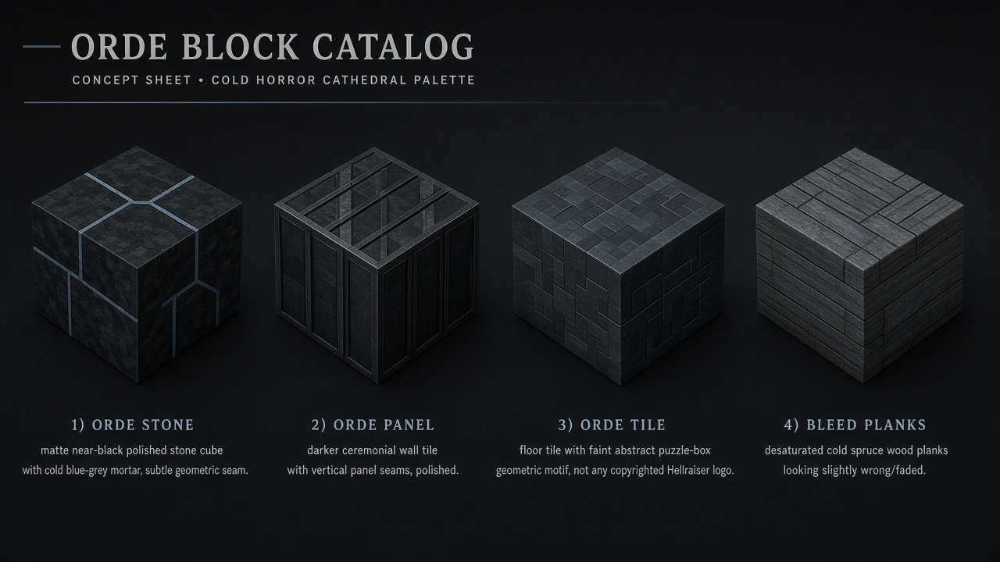
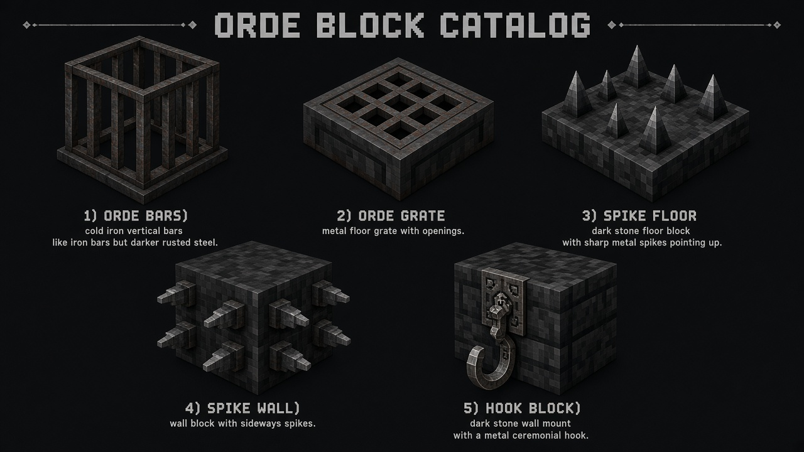
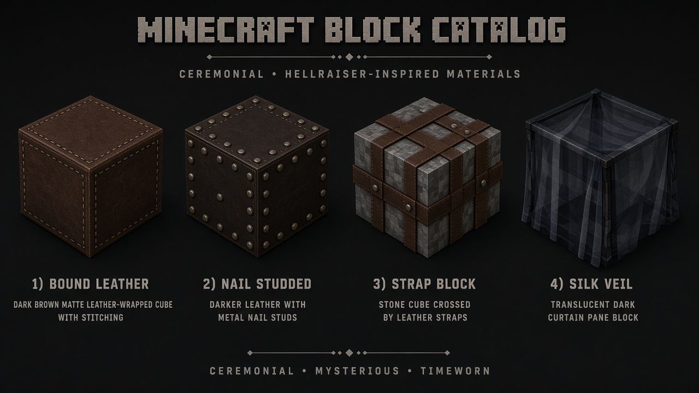
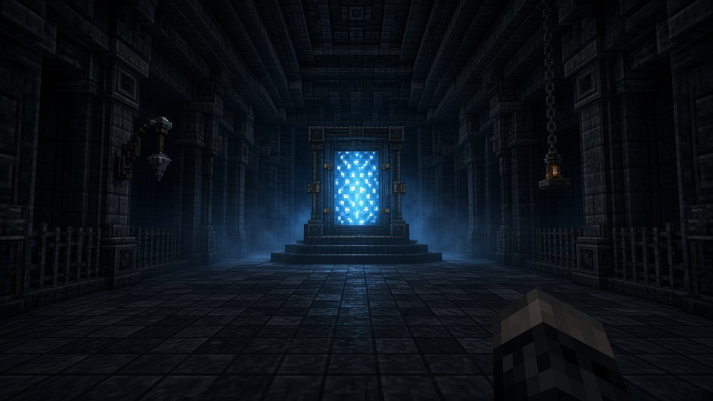
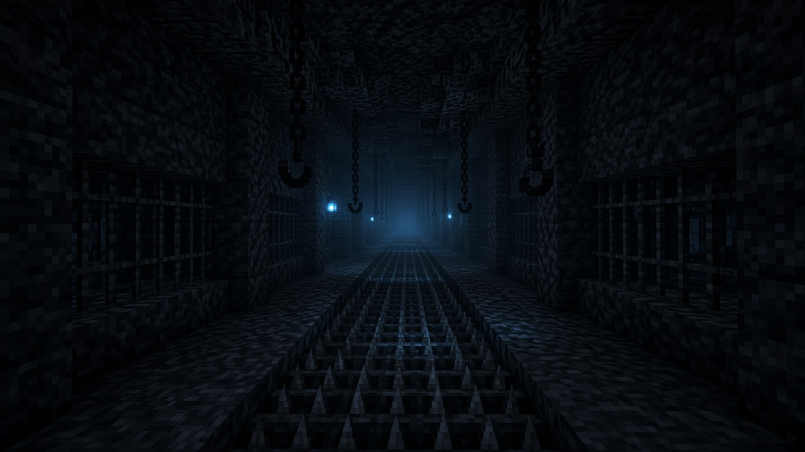
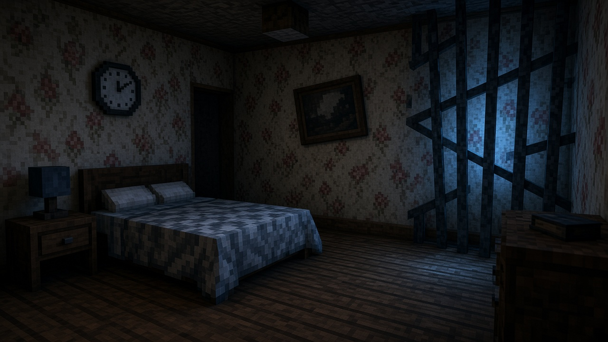
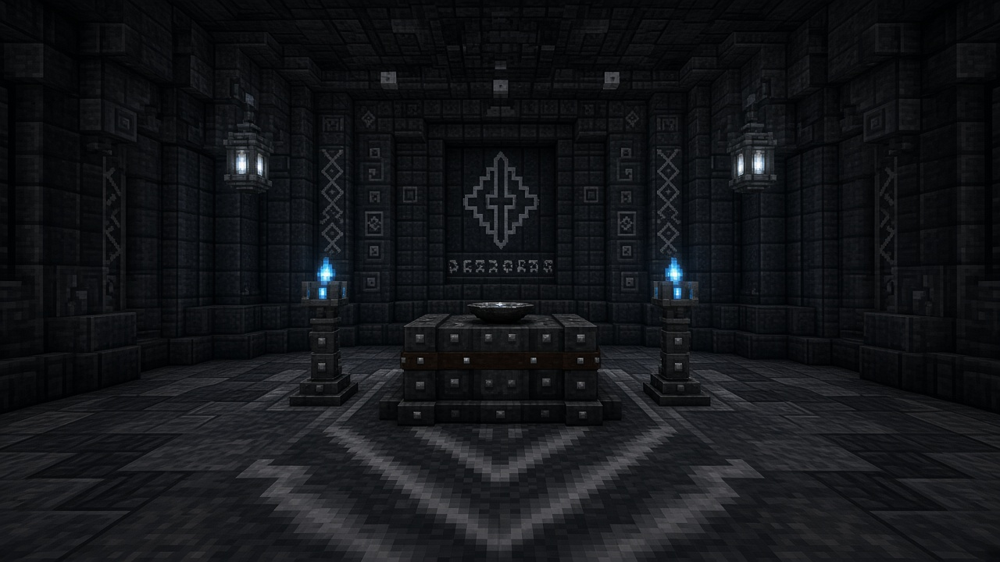

# Orde Block Catalog — Example Set (design)

**Status:** design catalog / example — **geen** volledige block-implementatie in deze PR.  
**Doel:** als we Cenobite-geïnspireerde blokken mogen maken, *dit* is wat ik zou shippen — een bruikbare catalogus voor Labyrinth-stamps, Orde-shrines, en domestic bleed.  
**Referenties (sfeer, geen IP-copy):** Hellraiser-films (ketting, leer, haak, koude ceremonie) + **Hellraiser: Revival** survival-horror Labyrinth (zwarte steen, roestijzer, koude blauwe gloed, draaiende gangen, pressure/puzzle props, huis dat “bleed”).  
**Lore-namen:** Orde / Gebondenen / Configuratie / Spijkermeester / De Ruit / Bleed — geen Pinhead/Leviathan/Chatterer als product-IDs.

**Huidige code-hook:** `LabyrinthMaterials` mapt vandaag naar vanilla stand-ins (`POLISHED_BLACKSTONE`, spruce planks, …). Deze catalogus zijn de **swap-targets** voor P5.2 / Orde-faith build-out.

**Concept-art:** `docs/images/orde-blocks/` (gegenereerde voorbeelden — geen finale textures).

---

## Visual examples (concept)

### Structure blocks (Tier A)

### Metal & spikes (Tier B–C)

### Bound / leather (Tier D)

### Kit — Arrival vestibule

### Kit — Spike corridor

### Kit — Domestic bleed bedroom

### Kit — City shrine

---

## 0. Visuele wetten (waarom dit setje)

| Wet | Wat je ziet | Minecraft-gevolg |
|-----|-------------|------------------|
| **Koude kathedraal** | Zwart/antraciet steen, glad + paneel, geen warmte | Orde-masonry set, geen crimson/nether-oranje |
| **Metaal = wet** | Roest, ketting, tralies, haken | Iron/chain set met custom sounds |
| **Ceremonie ≠ gore-spam** | Leer, straps, spijkers, kaarsen — suggestief | Leather / bound / spike props, geen blood-block flood |
| **Domestic bleed** | Echte huisblokken die “fout” zijn | Bleed wood + wrong furniture overlays |
| **Configuratie-logica** | Draaien, scharnieren, platen, sleuven | Interactable puzzle family (al deels: Scharnier) |
| **Licht = onheil** | Koud blauw / kaars / soul-achtig, geen torch-oranje | Orde lanterns + cold glow |

**Palette (hex intentie voor textures):**
- Stone: `#1A1A1E` → `#2C2C34` (mat, licht blauwgrijs in AO)
- Metal: `#3A2F2A` rust + `#5A5A62` cold steel
- Leather/bound: `#2A1814` / `#4A2C24`
- Accent cold: `#6B8FA8` / soul `#3D5A6C`
- Bleed wood: desaturated spruce `#3E342C`

---

## 1. Tier A — Structure (must-have voor Labyrinth + shrines)

Deze vervangen direct `LabyrinthMaterials` getters.

| ID | NL-naam | Rol | Variants | Notes |
|----|---------|-----|----------|-------|
| `orde_stone` | Orde-steen | Primary wall | full, stairs, slab, wall | Mat blackstone-feel; colder AO than vanilla |
| `orde_stone_bricks` | Orde-baksteen | Large nave faces | full, stairs, slab, wall | Slightly larger mortar grid |
| `orde_panel` | Orde-paneel | Trim / Approach / Audience | full, stairs, slab | Vertical seams; “polished ceremony” |
| `orde_tile` | Orde-tegel | Floor | full, slab | Subtle geometric Configuratie motif (niet Lament-logo) |
| `orde_pillar` | Orde-zuil | 1×1 decorative column | axis | Connects floor→ceiling in naves |
| `cold_vault` | Koude gewelfsteen | Vault band / ice bleed | full, slab | Replaces packed-ice stand-in; translucent edge optional |
| `ruit_heart` | Ruit-kern | Audience / Core accent | full | Soft pulse lightLevel 4–7; crying-obsidian stand-in |

**Ship first:** `orde_stone`, `orde_panel`, `bleed_planks` (↓) — exact P5.2 ids.

---

## 2. Tier B — Metal & containment (Revival corridor language)

| ID | NL-naam | Rol | Behavior |
|----|---------|-----|----------|
| `orde_bars` | Orde-tralies | Pane / cage | Like iron bars; colder sound |
| `orde_grate` | Orde-rooster | Floor / drain | Transparent collision partial; spikes below readable |
| `orde_chain_block` | Kettingmassa | Ceiling cluster | Non-full cube; hang aesthetic |
| `orde_hook_block` | Haakblok | Wall mount | Directional; decor + optional leash point later |
| `rust_plate` | Roestplaat | Industrial Orde belt | Full cube; rusty metal sound |
| `rust_stairs` / `rust_slab` | — | Trim | Pair with rust_plate |
| `orde_door` | Orde-deur | Heavy door | Iron-door like; Configuratie/SLEUTEL unlock later |
| `orde_trapdoor` | Orde-luik | Floor hatch | Over grate pits |

**Survival-horror beat:** roosters + tralies + haken in *elke* corridor vocabulary (niet alleen Core).

---

## 3. Tier C — Spikes, traps, Spijkermeester toolkit

Geïnspireerd op spike rooms / unsafe floors in Revival + classic Hellraiser “everything can hurt”.

| ID | NL-naam | Rol | Behavior (voorbeeld) |
|----|---------|-----|----------------------|
| `spike_floor` | Spijkervloer | Floor hazard | 1♥/s while standing; no knockback spam |
| `spike_wall` | Spijkermuur | Wall / corridor edge | Contact damage; directional |
| `spike_ceiling` | Spijkerplafond | Hang threat | Contact if player jumps into |
| `rusty_spike_floor` | Roestspijkers | Harder trap | Slower + short Weakness / “lock” feel (mild) |
| `retract_spike` | Intrekbare spijker | Puzzle / timed | Redstone or Configuratie pulse |
| `blade_rail` | Lemmetrail | Corridor edge | Thin collision; damage on touch |
| `hook_pendulum` | Haak-slinger | Decor → later entity | Static prop first; animate in O2+ |

**Balans:** damage laag maar *constant* — paniek door routing, niet one-shot. Max 1–2 spike types in first ship.

---

## 4. Tier D — Bound / leather / flesh-adjacent (ceremonieel)

Suggestief, geen gore-flood. “Scarlet Church meets cold Orde”.

| ID | NL-naam | Rol |
|----|---------|-----|
| `bound_leather` | Gebonden leer | Wall wrap / stretcher panels |
| `bound_leather_slab` | — | Half-height trim |
| `strap_block` | Riemblok | Cross-straps on stone (overlay-friendly) |
| `nail_studded` | Spijkerleer | Dark leather + metal studs |
| `bone_lattice` | Bottraliewerk | Rare chapel accent (not spam) |
| `silk_veil` | Zijden sluier | Non-solid curtain pane (Audience approach) |

**Texture rule:** matte, dry, museum-leather — not wet red.

---

## 5. Tier E — Domestic Bleed (huis dat fout is)

Vervangt / layers op `bleed_planks`. Dit is de “real world ↔ Labyrinth” as uit Revival.

| ID | NL-naam | Rol |
|----|---------|-----|
| `bleed_planks` | Bleed-planken | Primary domestic floor/wall |
| `bleed_planks_stairs` / `_slab` | — | Furniture builds |
| `bleed_wallpaper` | Bleed-behang | Wall: faded floral + cold tint |
| `bleed_carpet` | Bleed-tapijt | Carpet; optional hidden spike under |
| `wrong_door` | Verkeerde deur | Door that opens to wall / loop |
| `skew_frame` | Scheef frame | Item-frame-like decor block (baked skew) |
| `cold_hearth` | Koude haard | Fireplace that emits cold particles, no warm light |
| `stopped_clock` | Stilstaande klok | Wall decor; ambient tick rarely |

**Suite stamps** gebruiken 70% bleed + 30% Orde metal bleed-through (bars through wallpaper).

---

## 6. Tier F — Ritual & shrine furniture (overworld Orde faith)

Voor spelersteden met Cenobites + dorpschapters.

| ID | NL-naam | Rol |
|----|---------|-----|
| `orde_altar` | Orde-altaar | Shrine center; ritual presence point |
| `orde_candlestand` | Kandelaar | LightLevel 8 cold; particle smoke |
| `orde_lectern` | Orde-lessenaar | Lore / Memory Book stand |
| `offering_bowl` | Offerschale | Inventory 1 slot; ritual goods sink |
| `reliquary` | Reliekschrijn | Locked chest-like; relic store |
| `procession_pew` | Processiebank | Seat; Approach/Audience |
| `confession_niche` | Niche | Wall indent marker for stamps |

---

## 7. Tier G — Configuratie / puzzle family (Revival box logic)

Bouwt voort op bestaande `scharnier` + Configuratie-vormen.

| ID | NL-naam | Rol |
|----|---------|-----|
| `scharnier` | *(bestaat)* | Portal hinge |
| `config_slot` | Configuratie-sleuf | Accepts Configuratie vorm; opens door/gate |
| `rotary_plate` | Draaiplaat | Floor; rotates adjacent walkways (WIEL echo) |
| `pressure_orde` | Orde-drukplaat | Holds doors; quieter click |
| `puzzle_well` | Puzzelput | Multi-face “picture block” well (optional late) |
| `seal_socket` | Zegel-socket | Needs labyrinth_zegel / masker / koord |
| `beam_lens` | Straallens | Ruit-beam puzzle cover (late / optional) |

**Regel:** elke puzzle-block heeft een **duidelijke Configuratie-vorm** of relic-key — geen losse redstone-magie zonder lore.

---

## 8. Tier H — Light & atmosphere

| ID | NL-naam | Light | Mood |
|----|---------|-------|------|
| `orde_lantern` | Orde-lantaarn | 10 | Cold blue-white |
| `soul_censer` | Zielwierook | 7 | Smoke + whisper cue slot |
| `chain_candle` | Kettingkaars | 6 | Hanging candle cluster |
| `ruit_glow` | Ruit-gloed | 12 | Only near Audience |
| `void_sconce` | Leegte-wandlamp | 4 | Corridor fill, never warm |

---

## 9. Example “room kits” (hoe je de catalogus gebruikt)

### Kit 1 — Arrival vestibule
`orde_stone` + `orde_panel` + `orde_lantern` + `scharnier` + `orde_bars` + 1× `orde_hook_block`

### Kit 2 — Spike corridor (Revival unsafe hall)
`orde_stone` floor edges → `spike_floor` center strip OR `orde_grate` over `spike_floor` + `orde_bars` sides + `void_sconce`

### Kit 3 — Domestic bleed bedroom
`bleed_planks` + `bleed_wallpaper` + `bleed_carpet` + `skew_frame` + `stopped_clock` + metal `orde_bars` cutting through one wall

### Kit 4 — Orde shrine (player city)
`orde_altar` + 2× `orde_candlestand` + `offering_bowl` + `orde_tile` floor + `orde_panel` walls

### Kit 5 — Audience approach
`orde_panel` nave + `silk_veil` + `procession_pew` rows + `ruit_heart` focal + `ruit_glow`

---

## 10. Ship plan (als we dit bouwen)

| Wave | Levering | DoD |
|------|----------|-----|
| **B0** | `orde_stone`, `orde_panel`, `bleed_planks` (+ stairs/slab) + wire `LabyrinthMaterials` | Labyrinth leest niet meer als pure blackstone |
| **B1** | `orde_bars`, `orde_grate`, `orde_lantern`, `spike_floor` | Corridor vocabulary + 1 hazard |
| **B2** | `orde_altar`, `orde_candlestand`, `offering_bowl` | Overworld Cenobites shrine readable |
| **B3** | `bound_leather`, `hook_block`, `bleed_wallpaper`, `cold_hearth` | Bleed suites + ceremony |
| **B4** | `config_slot`, `rotary_plate`, `seal_socket` | Puzzle family beyond Scharnier |
| **B5** | Optional: `puzzle_well`, `retract_spike`, `blade_rail`, pendulum | Juice — only if B0–B4 groen |

**Art budget:** 16×16 textures first; connected textures later. Prefer *readable silhouettes* over detail noise.

**Performance:** no ticking block entities unless puzzle/altar; spikes = simple contact damage; lanterns = static light.

**IP:** textures original; no film stills; no Hellraiser logos; Configuratie ≠ Lament Configuration trademark art.

---

## 11. Wat ik *niet* in v1 zou maken

| Skip | Waarom |
|------|--------|
| Volledige flesh-block biomes | Tone + review risk; ceremony > body-horror flood |
| One-shot spike death pits everywhere | Route frustration; soft damage better |
| 50 decor variants day-one | Catalog bloated; kits above are enough |
| Exact Revival well puzzle clone | Optional late; own Configuratie language first |

---

## 12. Owner ask

1. Akkoord met **Tier A+B+C first** (B0–B1) als build-GO?  
2. Spikes: mild DoT OK, of alleen decor tot Orde-rituals klaar zijn?  
3. Overworld shrine set (B2) voor Cenobites-steden meteen meenemen?  
4. Display-naam “Cenobites” op items OK, of overal “Orde-” prefix?

**Aanbevolen:** ja op 1+3; spikes mild DoT; prefix `orde_` / `bleed_` in IDs, UI mag “Cenobites”-set noemen.
