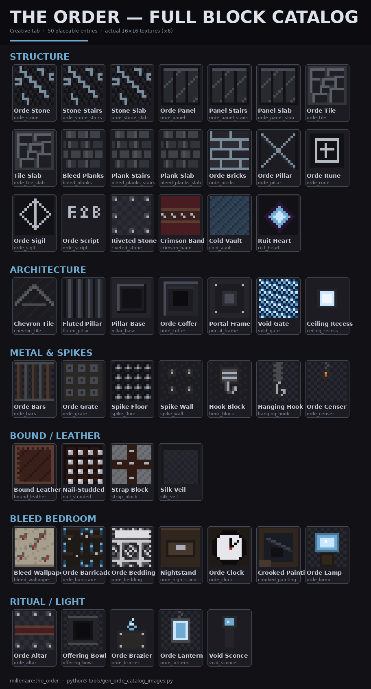
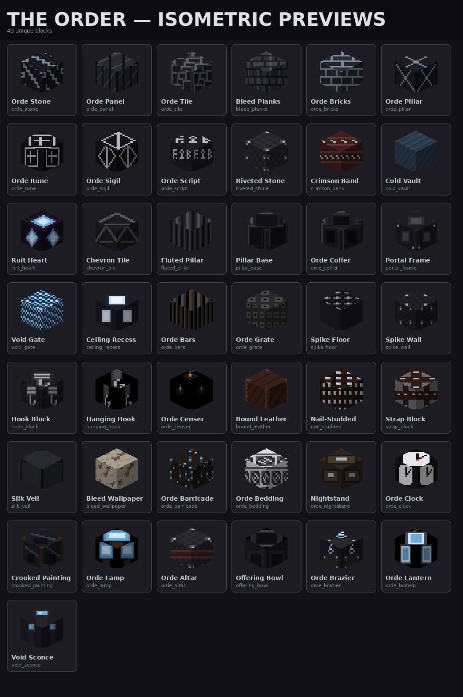
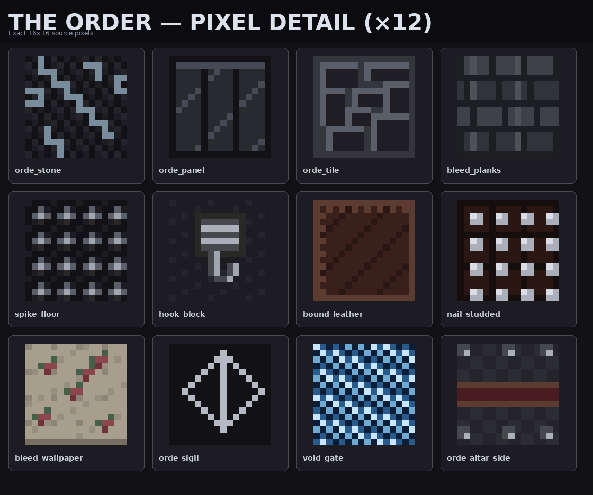

# The Order — Full Block Catalog

**Creative tab:** **The Order** (`itemGroup.millenaire.the_order`)  
**Placeable entries on tab:** **50** (43 unique primary + stairs/slabs)  
**Textures:** 16×16 PNG · generator `tools/gen_orde_assets.py`

---

## Catalog images (examples)

### Full grid — every tab entry



### Isometric previews — unique blocks



### Pixel detail (×12 nearest-neighbor)



### Concept art (design reference)

| Sheet | File |
|-------|------|
| Structure | [orde-block-structure.jpg](images/orde-blocks/orde-block-structure.jpg) |
| Metal & spikes | [orde-block-metal-spikes.jpg](images/orde-blocks/orde-block-metal-spikes.jpg) |
| Bound leather | [orde-block-bound-leather.jpg](images/orde-blocks/orde-block-bound-leather.jpg) |
| Arrival kit | [orde-kit-arrival.jpg](images/orde-blocks/orde-kit-arrival.jpg) |
| Spike corridor | [orde-kit-spike-corridor.jpg](images/orde-blocks/orde-kit-spike-corridor.jpg) |
| Bleed bedroom | [orde-kit-bleed-bedroom.jpg](images/orde-blocks/orde-kit-bleed-bedroom.jpg) |
| City shrine | [orde-kit-shrine.jpg](images/orde-blocks/orde-kit-shrine.jpg) |

---

## Complete inventory

### 1. Structure (sheets + shrine)

| # | ID | EN | NL | Shape | Notes |
|---|----|----|----|-------|-------|
| 1 | `orde_stone` | Orde Stone | Orde-steen | cube | Cold mortar seams |
| 2 | `orde_stone_stairs` | Orde Stone Stairs | Orde-steen trap | stairs | |
| 3 | `orde_stone_slab` | Orde Stone Slab | Orde-steen plaat | slab | |
| 4 | `orde_panel` | Orde Panel | Orde-paneel | cube | Vertical panel seams |
| 5 | `orde_panel_stairs` | Orde Panel Stairs | Orde-paneel trap | stairs | |
| 6 | `orde_panel_slab` | Orde Panel Slab | Orde-paneel plaat | slab | |
| 7 | `orde_tile` | Orde Tile | Orde-tegel | cube | Puzzle-box floor motif |
| 8 | `orde_tile_slab` | Orde Tile Slab | Orde-tegel plaat | slab | |
| 9 | `bleed_planks` | Bleed Planks | Bleed-planken | cube | Cold desaturated wood |
| 10 | `bleed_planks_stairs` | Bleed Plank Stairs | Bleed-plank trap | stairs | |
| 11 | `bleed_planks_slab` | Bleed Plank Slab | Bleed-plank plaat | slab | |
| 12 | `orde_bricks` | Orde Bricks | Orde-baksteen | cube | Shrine masonry |
| 13 | `orde_pillar` | Orde Pillar | Orde-zuil | cube | Diamond-stitch |
| 14 | `orde_rune` | Orde Rune | Orde-rune | cube | Border square |
| 15 | `orde_sigil` | Orde Sigil | Orde-sigil | cube | Diamond + vertical line |
| 16 | `orde_script` | Orde Script | Orde-schrift | cube | Glyph row |
| 17 | `riveted_stone` | Riveted Stone | Klinknagelsteen | cube | Corner rivets |
| 18 | `crimson_band` | Crimson Band | Karmozijnband | cube | Altar mahogany band |
| 19 | `cold_vault` | Cold Vault | Koud gewelf | cube | Labyrinth vault |
| 20 | `ruit_heart` | Ruit Heart | Ruit-kern | cube | Light 7 |

### 2. Architecture (arrival / shrine kits)

| # | ID | EN | NL | Notes |
|---|----|----|----|-------|
| 21 | `chevron_tile` | Chevron Tile | Chevron-tegel | V-floor toward altar |
| 22 | `fluted_pillar` | Fluted Pillar | Gegroefde zuil | Vertical ribs |
| 23 | `pillar_base` | Pillar Base | Zuilvoet | Inset square frame |
| 24 | `orde_coffer` | Orde Coffer | Orde-cassetteplafond | Coffered ceiling |
| 25 | `portal_frame` | Portal Frame | Portaalframe | Heavy portal masonry |
| 26 | `void_gate` | Void Gate | Leegtepoort | Blue energy, light 11 |
| 27 | `ceiling_recess` | Ceiling Recess | Plafondnis | Recessed light 8 |

### 3. Metal / spikes / hooks

| # | ID | EN | NL | Notes |
|---|----|----|----|-------|
| 28 | `orde_bars` | Orde Bars | Orde-tralies | IronBars pane |
| 29 | `orde_grate` | Orde Grate | Orde-rooster | Floor grate |
| 30 | `spike_floor` | Spike Floor | Spijkervloer | **1♥** step damage |
| 31 | `spike_wall` | Spike Wall | Spijkermuur | Side spikes |
| 32 | `hook_block` | Hook Block | Haakblok | Wall mount, facing |
| 33 | `hanging_hook` | Hanging Hook | Hangende haak | Ceiling chain + hook |
| 34 | `orde_censer` | Orde Censer | Orde-wierookvat | Light 6 |

### 4. Bound / leather

| # | ID | EN | NL | Notes |
|---|----|----|----|-------|
| 35 | `bound_leather` | Bound Leather | Gebonden leer | Edge stitching |
| 36 | `nail_studded` | Nail-Studded Leather | Spijkerleer | Stud grid |
| 37 | `strap_block` | Strap Block | Riemblok | Cross straps |
| 38 | `silk_veil` | Silk Veil | Zijden sluier | Pane / curtain |

### 5. Bleed bedroom

| # | ID | EN | NL | Notes |
|---|----|----|----|-------|
| 39 | `bleed_wallpaper` | Bleed Wallpaper | Bleed-behang | Beige floral |
| 40 | `orde_barricade` | Orde Barricade | Orde-barricade | Boarded + blue bleed |
| 41 | `orde_bedding` | Orde Bedding | Orde-beddengoed | Noise quilt |
| 42 | `orde_nightstand` | Orde Nightstand | Orde-nachtkastje | Drawer face |
| 43 | `orde_clock` | Orde Clock | Orde-klok | Facing wall clock |
| 44 | `crooked_painting` | Crooked Painting | Scheve schilderij | Facing wall art |
| 45 | `orde_lamp` | Orde Lamp | Orde-lamp | Table lamp, light 10 |

### 6. Ritual / light

| # | ID | EN | NL | Notes |
|---|----|----|----|-------|
| 46 | `orde_altar` | Orde Altar | Orde-altaar | Riveted + crimson |
| 47 | `offering_bowl` | Offering Bowl | Offerschale | Basin top |
| 48 | `orde_brazier` | Orde Brazier | Orde-vuurbekken | Light 10 |
| 49 | `orde_lantern` | Orde Lantern | Orde-lantaarn | Light 12, cutout |
| 50 | `void_sconce` | Void Sconce | Leegte-wandlamp | Light 4 |

### 6b. Wellgrid architecture (layout v3)

| # | ID | EN | NL | Notes |
|---|----|----|----|-------|
| 51 | `orde_arch` | Orde Arch | Orde-boog | Arch motif / lintels in well walls |
| 52 | `orde_parapet` | Orde Parapet | Orde-borstwering | Wall crown (WallBlock) |
| 53 | `gallery_rail` | Gallery Rail | Galerij-reling | Overlook railing (pane) |
| 54 | `void_beam` | Void Beam | Leegte-bundel | Sky pillar light 15 — De Ruit horizon anchor |

### 7. Also on The Order tab (existing Labyrinth / faith)

| ID | EN | Type |
|----|----|------|
| `scharnier` | Closed Hinge | block |
| `configuratie` | Configuratie | item |
| `labyrinth_zegel` | Labyrinth Seal | relic |
| `labyrinth_masker` | Labyrinth Mask | relic |
| `labyrinth_koord` | Labyrinth Cord | relic |

---

## Code hooks

| Area | Location |
|------|----------|
| Blocks | `ModBlocks` Orde section |
| Specials | `SpikeFloorBlock`, `HookBlock` |
| Items | `ModItems` block-items |
| Tab | `ModCreativeTabs.THE_ORDER_TAB` |
| Labyrinth | `LabyrinthMaterials` → stone / panel / bleed_planks / cold_vault / ruit_heart |
| Generator | `tools/gen_orde_assets.py` |
| Catalog images | `tools/gen_orde_catalog_images.py` |

---

## Regenerate

```bash
python3 tools/gen_orde_assets.py          # textures + block JSON
python3 tools/gen_orde_catalog_images.py  # catalog PNGs
```
