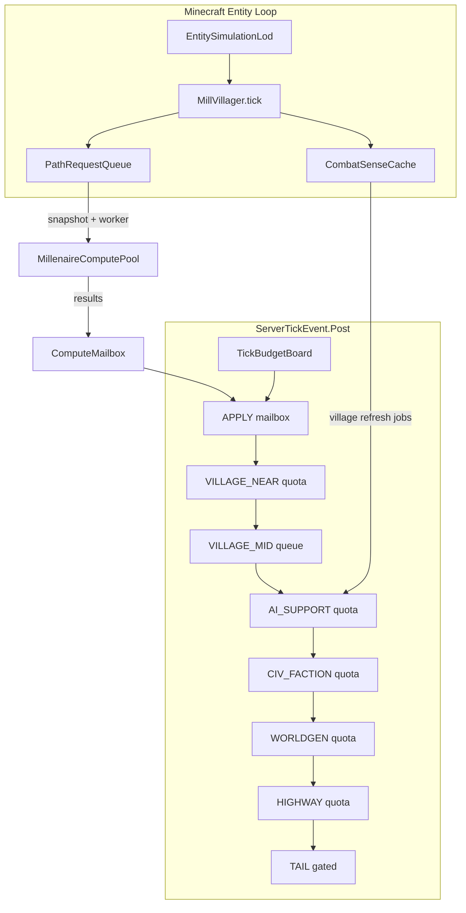

# Tick Performance Architecture — Production Plan

**Planner version:** 1  
**Package root:** `org.millenaire.perf`  
**Minecraft / NeoForge:** 1.21.1 / 21.1.x  
**Status:** APPROVED DIRECTION (implementation phased)  
**Closes audit item:** `FINAL_RELEASE_AUDIT.md` L-05 (runtime performance unverified)

---

## 0. Locked product decisions

| Decision | Choice | Rationale |
|----------|--------|-----------|
| Primary validation target | Singleplayer / small world (~3–5 populated villages + exploration worldgen) | Current use case |
| Architecture capacity | Sized for large dedicated servers (20+ villages, multiplayer) without rewrite | Future implementations must not re-open the tick model |
| Far fidelity policy | **Aggressive** — Far/inactive villages and distant NPCs drop to abstract / sleep simulation | Zero tick lag is the priority; near-player gameplay stays full fidelity |
| Near-player fidelity | Full — combat, goals, navigation, village systems behave as today within Near band | Player-visible quality is non-negotiable |
| Budget model | Hard per-phase millisecond + op quotas with mandatory deferral; soft “best effort” is not enough | Soft 10 ms shared deadline already exists and still allows overruns |

These decisions are binding for all phases below. New features that cannot state their tick cost and deferral policy are rejected at design review.

---

## 1. Problem statement

### 1.1 Symptom

Server tick time (MSPT) spikes and sustained lag while Millénaire systems run: villages, villagers, pathfinding, civilization, worldgen, highways, boss events.

### 1.2 Root cause (current codebase)

Almost all Millénaire **scheduled** work funnels through one `ServerTickEvent.Post` listener in `Millenaire.java`. A soft shared deadline (`worldgenTickTimeBudgetMs`, default 10 ms) via `MaterializationTickBudget` / `ServerTickGovernor` is **advisory**. Callers that never check `hasTime()`, and all work on Minecraft’s **entity tick loop**, can still dominate the frame.

**Highest-impact leaks today:**

1. **`MillVillager` entity ticks** — outside the governor; every loaded villager runs `super.tick`, combat maintenance, goal scheduler, and often navigation every tick. `VillagerAiCadence` only amortizes idle goal-pick.
2. **Near `Village.tick` × N** — no village-level skip when the deadline is already spent; integrity, growth, markets, path recalc can spike.
3. **Synchronous entity A\*** — `MillPathFinder` allows up to **25 ms** wall-clock per search; `MillPathNavigation` multiplies node budget ×8. Path storms can alone exceed a 50 ms tick.
4. **Combat AABB scans** — urgent combat `canStart` runs every tick even when goal-pick is skipped; hostile/hunt/`callForHelp` use large `getEntitiesOfClass` boxes.
5. **Village path snapshot + A\*** — `PathTerrainSnapshot.capture` is dense main-thread `getBlockState`; rejected compute jobs fall back to sync A\*.
6. **Ungated / weakly gated Post-tick systems** — bounty hunters, world boss planner, `FactionLifecycle` (no `hasTime`), AI_SUPPORT phase entry, always-on `backgroundTick` for every village.

### 1.3 Why incremental patches failed

Adding more `hasTime()` checks without:

- bringing **entity AI** under a simulation LOD,
- capping **pathfinding** hard,
- aggregating **combat scans**,
- and enforcing **phase quotas**,

cannot guarantee a lag-free tick. Soft fairness without preemption and without entity coverage is not a production tick model.

---

## 2. Success criteria (SLOs)

Measured on a warm singleplayer world with Millénaire content loaded. Vanilla + other mods excluded from Millénaire attribution via Spark / `/millenaire dev tick` phase timers.

### 2.1 Primary SLOs (must pass before “perf done”)

| ID | Metric | Target | Load profile |
|----|--------|--------|--------------|
| SLO-1 | Sustained server MSPT | **≤ 40 ms** p95 (≥ 25 TPS equivalent) | 4 populated Near/Mid villages, player in one village, no boss |
| SLO-2 | Millénaire Post-tick attribution | **≤ 12 ms** p95 wall time across governor phases | Same as SLO-1 |
| SLO-3 | Millénaire entity-AI attribution | **≤ 15 ms** p95 for all `MillVillager` ticks combined | Same as SLO-1 with ≥ 80 loaded villagers |
| SLO-4 | Single path search budget | **≤ 2 ms** hard abort (entity); village grid A\* never blocks > 2 ms on main thread | Path storm (many dest changes) |
| SLO-5 | Spike recovery | After worldgen exploration burst or path recalc, MSPT returns under SLO-1 within **5 seconds** | Fly through unexplored regions with worldgen on |
| SLO-6 | Far village cost | Far/inactive village average **≤ 0.05 ms** / village / tick (background only) | 10+ distant villages in SavedData |

### 2.2 Capacity SLOs (architecture must support; validated later)

| ID | Metric | Target | Load profile |
|----|--------|--------|--------------|
| CAP-1 | MSPT p95 | ≤ 45 ms | 15 villages, 2 players, civ + highways on |
| CAP-2 | MSPT p95 | ≤ 50 ms | 25 villages, exploration + civ + one boss event |

### 2.3 Non-goals

- Client FPS / render optimization (except not making server send more packets under load).
- Removing features to “fix” lag.
- Guaranteeing 20 TPS when the machine is CPU-starved by other mods; Millénaire must still respect its own budgets.

### 2.4 Gameplay fidelity contract

| Band | Distance / state | Required feel |
|------|------------------|---------------|
| **Near** | Within village keep-active / AI mid distance of any player | Full AI, combat, pathing, village systems |
| **Mid** | Active, chunks may be loaded, beyond Near | Visible but amortized: staggered village tick, reduced goal-pick, shared combat cache, async path |
| **Far** | Inactive / beyond unload / no nearby player | Abstract simulation only: `backgroundTick` + civ/living budgets; **NPCs may sleep** (no goal-pick, no combat scans, no leaf clear, minimal vanilla nav) |

Aggressive Far sleep is explicit product policy for this plan.

---

## 3. Target architecture



### 3.1 System inventory (build / upgrade)

| System | Package | Role |
|--------|---------|------|
| **TickBudgetBoard** | `perf.tick` | Evolves `ServerTickGovernor` + `MaterializationTickBudget` into per-phase ms + op quotas with mandatory defer |
| **WorkScheduler** | `perf.tick` | Priority queues for Mid villages, integrity scans, path applies, civ stage retries |
| **EntitySimulationLod** | `perf.tick` | Near/Mid/Far for entities; Far sleep policy |
| **VillageSimulationLod** | `perf.tick` | Existing; extend Far for active-but-distant; Near deferral under budget |
| **VillagerAiCadence** | `perf.tick` | Existing; extend combat-preemption cadence + Mid/Far rates |
| **PathRequestQueue** | `perf.path` | Caps concurrent main-thread and async entity pathfinds |
| **NavRegionSnapshot** | `perf.path` | Immutable walkability capture for async entity A\* |
| **CombatSenseCache** | `perf.sense` | Per-village monster/hostile/item entity caches refreshed on budget |
| **VillageWorkSlice** | `village` | Break `Village.tick` into sliceable jobs with checkpoints |
| **ComputePool / Mailbox** | `perf.compute` | Existing; expand job types + apply time budget |
| **PerfTelemetry** | `perf.telemetry` | Rolling histograms, `/millenaire dev tick` enrichment, Spark-friendly names |
| **PerfContract** | docs + checklist | Gate for every new feature PR |

---

## 4. System designs (detailed)

### 4.1 TickBudgetBoard (hard phase economy)

**Replaces the mental model of “one soft 10 ms pie everyone nibbles.”**

Keep a global soft ceiling (config, default **12 ms** Millénaire Post-tick for SP) but allocate **phase quotas**:

| Phase | Default ms (SP) | Ops / notes |
|-------|-----------------|-------------|
| APPLY | 2 | `computeApplyBudgetPerTick` + **apply time** cap |
| VILLAGE_NEAR | 4 | Max Near villages fully ticked per frame; remainder deferred FIFO |
| VILLAGE_MID | 2 | Existing Mid queue hardened |
| AI_SUPPORT | 1 | Living / religion / gossip; must call `hasTime` at entry |
| CIV_FACTION | 1.5 | Stages already defer; FactionLifecycle must too |
| WORLDGEN | 2 | Existing op/scan budgets remain |
| HIGHWAY | 1 | Existing |
| BOSS_QUEST_MAP + TAIL | 0.5 | Boss planner must be sliceable; tail skips if over |

**Rules:**

1. Entering a phase records remaining quota; `hasTime(phase)` is false when phase or global deadline spent.
2. **No phase may start a known-expensive unit** (integrity scan, path snapshot, claim-heat recompute) without a time check.
3. Deferred work goes to `WorkScheduler` with generation tokens (stale drops).
4. `tryContinue` becomes the standard gate; unused APIs are deleted or wired everywhere.
5. Config: `tickGovernor.globalBudgetMs`, `tickGovernor.phase.<name>Ms`, plus existing worldgen op knobs.

**Near village deferral (new):** if VILLAGE_NEAR quota is spent, remaining Near villages enqueue for next ticks (round-robin so no village starves). This is the critical gap vs today’s Mid-only deferral.

### 4.2 EntitySimulationLod (closes the entity leak)

New resolver parallel to `VillageSimulationLod`, keyed by entity ↔ nearest player distance (and village LOD when assigned).

| LOD | Entity policy |
|-----|---------------|
| Near | Today’s full tick |
| Mid | Goal-pick every N ticks (existing cadence); combat preemption every M ticks unless `attackTarget != null` or village raid; skip leaf clear / outdoor probes; nav via PathRequestQueue only |
| Far | **Sleep:** skip goal-pick, combat scans, leaf clear, passive pickup, speech; skip `navManager.tick` unless hired/escort/raid flagged; optionally freeze non-essential goal tasks; still run minimal `super.tick` physics if entity must exist |

**Chunk-loaded Mid villagers** remain visible (walk current path, finish current task) but cannot start unbounded scans.

**Integration points:** `MillVillager.tick` / `aiStep`, `GoalScheduler.tick`, `VillagerNavigationManager.tick`.

**Config:** distances + intervals under `tickGovernor.entityLod.*`.

### 4.3 PathRequestQueue + async entity pathfinding

**Problem:** Entity `moveTo` → `MillPathFinder` can burn 25 ms synchronously.

**Design:**

1. Cap `SEARCH_TIME_BUDGET_NANOS` to **2 ms** (config); reduce `MillPathNavigation` node multiplier (×8 → configurable, default ×2 Near / ×1 Mid).
2. Introduce `PathRequestQueue`:
   - Max **K** new path searches started per tick globally (default 4 SP).
   - Max **1** in-flight async path per villager; coalesce destination updates.
   - Prefer waypoint/macro nav for distance > 48 (already present); promote stuck local → macro under governor.
3. Async path:
   - Main thread captures `NavRegionSnapshot` (bounded box, amortized columns) **only if** TickBudgetBoard allows.
   - Worker runs A\* on snapshot (`ComputeJob` contract: no `ServerLevel`).
   - `ComputeMailbox` applies path to mob if generation matches.
4. On queue full / reject: keep last path, extend backoff (`pathfindBackoffTicks`), never sync-fallback a 25 ms search.
5. Honor unused `REPATH_INTERVAL` for combat retarget (`navigateToCombatTarget`).

Village paths keep the existing offload path; additionally:

- Amortize `PathTerrainSnapshot.capture` (column slices / reuse across generation).
- Apply path placement under APPLY time budget.
- Never autobuild all routes in one call without slicing.

### 4.4 CombatSenseCache (scan aggregation)

**Problem:** Per-villager AABB scans every tick for combat preemption.

**Design:**

| Sense | Refresh | Consumers |
|-------|---------|-----------|
| Monsters in village box | Every 10 ticks, one scan / village | `VillagerCombat.triggerMobAttacks`, hunt goals |
| Hostile living (raid/war) | Every 10–20 ticks / village | `HostileVillagerGoal`, `CombatGoalSupport` |
| Ground items | Existing GatherGoods village cache | Gather goals |
| Call-for-help recipients | Cache MillVillagers in 80-block box / village | `CombatHelper.callForHelp` |

Combat preemption in `GoalScheduler` when Mid/Far: read cache only; full `canStart` world queries forbidden on Far; Mid at reduced cadence unless already in combat.

Boss entities stay event-scoped; reuse budgets, do not go through village cache.

### 4.5 VillageWorkSlice (sliceable Village.tick)

Refactor `Village.tick` into ordered slices with checkpoints:

1. Reservations / cheap bookkeeping (always if Near scheduled)
2. Integrity / orphan cleanup → **WorkScheduler** job, 256 entities or N ms / tick
3. Growth / despawn → already staggered; also governor-gated
4. Path manager tick → one unit under budget
5. Markets / visitors / pens / panels / marvel → existing `hasTime` gates kept
6. Seller / goods refresh → interval + budget

**Near deferral** skips slices 2–6 for villages beyond the per-tick Near quota; slice 1 may still run if cheap enough (or entire village defers — prefer entire defer for simplicity and fairness).

`backgroundTick` for Far stays raid/diplomacy/hire only; must not call integrity or path recalc.

### 4.6 Civilization / faction / AI_SUPPORT hardening

- `CivilizationOrchestrator`: keep stage deferral; add phase ms check before heavy bridges (`NeedsTradeBridge`, claim heat).
- `FactionLifecycle`: **must** call TickBudgetBoard the same way as civ stages.
- Bounty hunter tickers: enter CIV or dedicated slice; `hasTime` gate.
- `WorldBossEventPlanner`: slice spawn attempts; structure avoidance sparse; never unbounded per tick.
- AI_SUPPORT: entry `hasTime`; living/religion already have internal budgets — enforce early exit.

### 4.7 ComputePool expansion

| Job type | Capture (main) | Compute (worker) | Apply (main) |
|----------|----------------|------------------|--------------|
| Village path trace | existing snapshot | grid A\* | place / store route |
| Waypoint graph | existing | edge prep | publish |
| Entity path | NavRegionSnapshot | mob A\* on grid/nodes | set Path on mob |
| Highway / worldgen | existing flags | existing | existing |
| Combat sense (optional later) | none (main-only refresh is fine) | — | — |

Pool reject policy: **never** fall back to expensive sync; enqueue to WorkScheduler or drop with backoff.

Apply side: budget by **count and ms**.

### 4.8 PerfTelemetry

Extend `TickCommand` / `ServerTickGovernor.diagnostic()`:

- Per-phase ms, defer counts (existing)
- Entity LOD counts (near/mid/far sleep)
- Path queue depth, async accept/reject/stale, sync searches, search p95 ms
- Combat cache refresh counts / AABB queries avoided
- Near village defer queue depth
- Rolling 20s / 60s histograms in memory (no disk spam)

Spark section names: `millenaire/tick/<phase>`, `millenaire/entity/lod/<band>`, `millenaire/path/<sync|async>`.

Optional: write `perf-snapshot.json` from `/millenaire dev tick dump` for bug reports.

### 4.9 PerfContract (future-proofing)

Every new Millénaire feature PR that runs on server tick or entity tick must include a short **Perf Contract** block in the PR / architecture note:

1. **Phase** it runs in (or Entity LOD band).
2. **Worst-case cost** per invocation (ms / ops).
3. **Cadence** (every tick / N ticks / event-driven).
4. **Deferral policy** when budget spent (queue / skip / coalesce).
5. **Thread rules** (main vs compute; no world access on workers).
6. **SLO impact** — which SLO-# it could threaten and how capped.

Checklist file: `docs/PERF_CONTRACT_CHECKLIST.md` (companion). CI does not auto-enforce logic, but release audit L-05 is only cleared when contracts exist for civ, living, worldgen, boss, paths, and entity AI.

---

## 5. Implementation phases

Phases are sequential gates. Do not start phase N+1 until phase N acceptance passes on the SP load profile.

### Phase 0 — Instrumentation baseline (1–2 days)

**Goal:** Measure before changing behavior.

- Enrich `/millenaire dev tick status|metrics` with entity counts, path counters, phase remaining ms.
- Add `NavigationCounters` / new counters for search ms histogram, queue depth.
- Document Spark workflow in `docs/TICK_PERFORMANCE_LOCAL_VALIDATION.md`.
- Capture baseline numbers on a reference SP world (4 villages).

**Exit:** Baseline report checked into docs or attached to issue; L-05 marked “instrumented, not yet fixed.”

### Phase 1 — TickBudgetBoard + Near deferral (3–5 days)

**Goal:** Post-tick Millénaire work cannot monopolize the frame.

- Split global soft deadline into phase quotas (`TickBudgetBoard`).
- Near village round-robin deferral queue (mirror Mid).
- Gate AI_SUPPORT, FactionLifecycle, bounty hunters, boss planner slices.
- Config surface under `tickGovernor.*`.
- Unit tests: quota exhaustion defers; round-robin fairness; diagnostic string.

**Exit:** SLO-2 met on synthetic “many villages” unit/integration harness; SP smoke shows Mid+Near defer counters under load.

### Phase 2 — EntitySimulationLod + aggressive Far sleep (4–6 days)

**Goal:** Entity loop stops being an uncapped swarm.

- Implement `EntitySimulationLod` + wire `MillVillager` / `GoalScheduler`.
- Far sleep policy as specified; Mid combat cadence.
- Telemetry: `aiSleep`, lod counts.
- Tests: stagger parity, sleep skips scans, Near unchanged.

**Exit:** SLO-3 met on ≥80 villagers with player in one village and others Mid/Far.

### Phase 3 — Path hard caps + PathRequestQueue (+ async entity path) (5–8 days)

**Goal:** No single path search can stall the tick.

- 2 ms entity search abort; lower node multiplier.
- `PathRequestQueue` global/per-villager caps; no expensive sync fallback.
- Async entity path via compute pool + mailbox (same pattern as village paths).
- Amortize village `PathTerrainSnapshot.capture`; slice autobuild.
- Combat repath interval enforced.

**Exit:** SLO-4 + path-storm test; reject/backoff metrics prove no 25 ms searches.

### Phase 4 — CombatSenseCache + GoalScheduler preemption reform (3–5 days)

**Goal:** Combat does not mean O(villagers × AABB) every tick.

- Per-village sense caches; wire hostile/hunt/aggro/help.
- Mid/Far preemption reads cache only.
- Tests: cache hit avoids world query; raid still acquires targets within refresh latency.

**Exit:** Profiler shows AABB query rate drop ≥ 70% at Mid distance with equal combat success in Near.

### Phase 5 — VillageWorkSlice + integrity/despawn jobs (3–5 days)

**Goal:** Village.tick spikes eliminated.

- Slice integrity / orphan cleanup / heavy panels into WorkScheduler.
- Ensure Far `backgroundTick` never starts path/integrity.
- Tests: integrity progresses across ticks; no full-box scan when budget spent.

**Exit:** SLO-1 and SLO-6 met on reference world; no integrity hitch > 5 ms.

### Phase 6 — Apply-time budgets, civ/worldgen polish, CAP dry-run (3–5 days)

**Goal:** Mailbox apply and secondary systems respect the board; prove headroom for future MP.

- APPLY ms cap; drop/stale-safe.
- Claim heat / exporter scans already gated — verify under board.
- Worldgen/highway remain within phase quotas during exploration (SLO-5).
- Dry-run CAP-1 profile (optional save with many villages).

**Exit:** SLO-1…SLO-6 green; CAP-1 measured (pass or documented gap with config knobs).

### Phase 7 — Hardening, docs, audit close (2–3 days)

- `docs/TICK_PERFORMANCE_LOCAL_VALIDATION.md` full checklist.
- `docs/PERF_CONTRACT_CHECKLIST.md`.
- README section pointing at tick governor / LOD / commands.
- Mark L-05 verified with evidence links.
- Default configs tuned for SP; comments document MP scaling knobs.

---

## 6. Module / file ownership map

| Area | Primary files (existing → evolve) |
|------|-----------------------------------|
| Tick board | `perf/tick/ServerTickGovernor.java`, `TickPhase.java`, `worldgen/materialize/MaterializationTickBudget.java`, `config/MillenaireServerConfig.java` |
| Wiring | `Millenaire.java` Post listener |
| Village LOD / defer | `village/VillageManager.java`, `perf/tick/VillageSimulationLod.java`, `village/Village.java` |
| Entity LOD | **new** `perf/tick/EntitySimulationLod.java`, `entity/MillVillager.java`, `goal/GoalScheduler.java` |
| Path | `entity/MillPathFinder.java`, `MillPathNavigation.java`, `VillagerNavigationManager.java`, **new** `perf/path/*`, `village/path/VillagePathManager.java`, `PathTerrainSnapshot.java` |
| Combat sense | **new** `perf/sense/CombatSenseCache.java`, `entity/VillagerCombat.java`, `goal/impl/HostileVillagerGoal.java`, `HuntMonsterGoal.java`, `combat/CombatHelper.java` |
| Compute | `perf/compute/MillenaireComputePool.java`, `ComputeMailbox.java`, `ComputeOffload.java` |
| Civ / faction | `CivilizationOrchestrator.java`, `FactionLifecycle.java`, `InteractionTicker.java`, `NeedsTradeBridge.java` |
| Boss / tail | `WorldBossEventPlanner.java`, map sync / quests (already tail-gated) |
| Commands | `command/TickCommand.java` |
| Tests | `src/test/java/org/millenaire/perf/**` |

---

## 7. Configuration surface (target)

Under `millenaire-server.toml` → `tickGovernor` (extend existing):

```
enabled = true
globalBudgetMs = 12

phase.applyMs = 2
phase.villageNearMs = 4
phase.villageMidMs = 2
phase.aiSupportMs = 1
phase.civFactionMs = 1.5
phase.worldgenMs = 2
phase.highwayMs = 1
phase.tailMs = 0.5

villageLodEnabled = true
villageLodMidInterval = 2
nearVillageMaxFullTicksPerTick = 2
nearDeferEnabled = true

entityLodEnabled = true
entityLodMidDistance = 48
entityLodFarDistance = 96
entityLodMidGoalInterval = 3
entityLodMidCombatInterval = 5
entityLodFarSleep = true          # aggressive policy

villagerAiCadenceEnabled = true   # kept; Entity LOD owns policy

path.maxSearchMs = 2
path.nodeMultiplierNear = 2
path.nodeMultiplierMid = 1
path.maxStartsPerTick = 4
path.asyncEntityPath = true
path.combatRepathInterval = 10

combatSense.refreshInterval = 10
combatSense.enabled = true
```

Worldgen op budgets remain; `worldgenTickTimeBudgetMs` becomes the **fallback global** if phase board disabled, or is aliased to `globalBudgetMs` (single source of truth — prefer alias to avoid two clocks).

---

## 8. Testing strategy

### 8.1 Unit (CI)

- TickBudgetBoard quota / defer / fairness
- VillageSimulationLod + EntitySimulationLod math
- VillagerAiCadence / combat cadence
- PathRequestQueue coalesce + reject
- CombatSenseCache freshness
- Compute pool submit/shutdown (existing)
- Snapshot determinism / stale generation drop

### 8.2 Integration (CI where Minecraft test harness allows)

- Governor + VillageManager Near deferral under fake clock
- Mailbox apply respects apply ms budget
- GoalScheduler Far sleep skips world queries (mock level or counters)

### 8.3 Local validation (owner / release)

See companion `TICK_PERFORMANCE_LOCAL_VALIDATION.md` (Phase 0 deliverable):

1. Reference SP world script (village count, player path).
2. Spark 60s sampler at rest in village / during path storm / during exploration.
3. `/millenaire dev tick metrics` before/after each phase.
4. CAP-1 optional weekend stress.

### 8.4 Regression gameplay

Near village: build, gather, hunt, raid, trade, hire escort — must match pre-change feel.  
Mid: may look “slower to decide” but not frozen.  
Far: may sleep; waking when player approaches within one refresh interval (≤ 1s).

---

## 9. Risk register

| Risk | Impact | Mitigation |
|------|--------|------------|
| Far sleep looks broken if chunks stay loaded | Player sees statues | Wake on player enter Mid distance within 1 refresh; hired/escort/raid never Far-sleep |
| Async path feels laggy | NPCs pause before walking | Keep last path; allow short sync micro-path (≤ 2 ms) toward first waypoint only |
| Near deferral starves a village | Growth stalls | Round-robin queue + minimum full tick every N ticks even if over budget (credit debt) |
| Compute pool saturation | Queue reject storms | Cap submits; backoff; never sync-fallback expensive work |
| Two clocks (worldgen vs governor) | Confusing config | Alias to one `globalBudgetMs` |
| Other mods steal the tick | SLO-1 fails unfairly | Document Millénaire attribution; keep Millénaire under SLO-2/3 regardless |
| Scope creep across features | Plan never finishes | Phase gates; PerfContract rejects uncapped work |

---

## 10. Definition of Done

The tick performance program is **done** when:

1. SLO-1…SLO-6 pass on the reference SP profile with evidence (Spark + tick metrics dump).
2. Phases 0–7 merged; defaults ship with `entityLodFarSleep=true` and path max search 2 ms.
3. `/millenaire dev tick metrics` exposes phase, entity LOD, path queue, combat cache stats.
4. `PERF_CONTRACT_CHECKLIST.md` exists; L-05 in `FINAL_RELEASE_AUDIT.md` updated to verified with links.
5. README documents the tick model for contributors.
6. No Millénaire server system remains that can start unbounded main-thread A\* or full-village integrity scans without a budget check.

---

## 11. Immediate next implementation step

After plan approval: **execute Phase 0** (instrumentation baseline) then **Phase 1** (TickBudgetBoard + Near deferral). Do not start Entity LOD until Post-tick quotas and Near deferral land — otherwise entity work and village work will fight without a fair board.

---

## Appendix A — Current hotspot map (pre-fix)

| Rank | Hotspot | Location |
|------|---------|----------|
| 1 | MillVillager AI swarm | `entity/MillVillager.java` tick/aiStep |
| 2 | Near Village.tick | `village/Village.java` |
| 3 | Sync entity A\* ≤25 ms | `entity/MillPathFinder.java` |
| 4 | Village path snapshot + A\* | `village/path/*` |
| 5 | Combat AABB / preemption | `GoalScheduler`, `VillagerCombat`, hostile/hunt goals |
| 6 | Worldgen materialize under exploration | `WorldgenEngine` |
| 7 | Civ claim heat / trade scans | `InteractionTicker`, `NeedsTradeBridge` |
| 8 | Boss + bounty ungated slices | `WorldBossEventPlanner`, bounty tickers |

## Appendix B — Relationship to existing soft governor

The uncommitted / recent work (`ServerTickGovernor`, `VillageSimulationLod`, `VillagerAiCadence`, `TickCommand`, compute offload for village paths) is **Phase-0/1 foundation**, not the finished model. This plan **keeps and hardens** that foundation; it does not rip it out. Soft-only checks become phase quotas + entity LOD + path/combat systems above.
