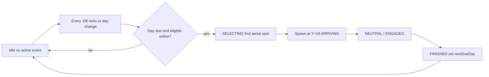

# World Boss — Day Cadence + Quiet Aerial Spawn Plan

**Status:** READY TO IMPLEMENT  
**Parent:** `docs/WORLD_BOSS_EVENTS_ARCHITECTURE.md`  
**Related perf plan:** `docs/TICK_PERFORMANCE_ARCHITECTURE.md` (boss entity combat remains the real MSPT cost)

---

## 0. Honest performance answer

| Change | Cuts steady tick lag? |
|--------|------------------------|
| Stop per-tick playtime counter / SavedData dirty | **Tiny** idle win only (not your lag) |
| Remove announce show (chat/sound/particles + 4s wait) | **No** for MSPT; nicer + less one-shot spam |
| Spawn every 5 Minecraft days | **No** for MSPT; product cadence change |
| Keep aerial descent only | Already exists; quiet path is fine |
| Active Hemelwachter in the sky fighting | **This is the boss MSPT cost** — unchanged by this plan |

**Verdict:** Do this for gameplay (“no countdown show, every 5 days, drop from sky”). Do **not** expect it to fix general tick problems. Those need the tick-performance architecture (entity LOD, path caps, village budgets).

There is **no client countdown HUD** today. `/worldboss next` is on-demand. The “counter” is server SavedData `elapsedActiveTicks` += 1 each tick while someone eligible is online, plus `setDirty()` every advancing tick.

---

## 1. Locked product decisions

1. **Cadence:** every **5 Minecraft days** (overworld `dayTime` / day index), configurable (`intervalDays`, default 5).
2. **Still require** ≥1 eligible player online before starting SELECTING (no spawn into empty world).
3. **No backlog:** if the player is offline across many days, at most **one** event becomes due (same as today).
4. **Sleep / `/time set`:** day-based cadence **does** advance with world time (intentional change from “active playtime only”). Document clearly.
5. **Show:** no pre-spawn ceremony — skip announce chat/sound/particles and the 80-tick ANNOUNCING wait. Spawn high → **ARRIVING** descent only. Keep provoke bossbar later.
6. **Admin commands** (`/worldboss spawn|next|…`) keep working.

---

## 2. Target behaviour



- Persist `nextDueDayIndex` (or `lastEventDayIndex`) in `WorldBossEventSavedData`.
- Day index = `level.getDayTime() / 24000L` (overworld).
- On finish: `nextDueDayIndex = currentDay + intervalDays`.
- Idle planner: **do not** `elapsed++` / dirty every tick. Check due on day change or every N ticks (e.g. 100).

---

## 3. Code changes

| Area | File | Change |
|------|------|--------|
| Timer logic | `WorldBossTimerLogic.java` | Add day-index helpers: `dayIndex(dayTime)`, `isDue(currentDay, nextDueDay)`, `nextDue(currentDay, intervalDays)`; keep old tick helpers deprecated or for migration |
| SavedData | `WorldBossEventSavedData.java` | Add `nextDueDayIndex`, schema bump `CURRENT_VERSION` 1→2; migrate: if old tick fields present, convert approx (`elapsed/interval` → due today or +1 day) then stop writing per-tick elapsed |
| Planner idle | `WorldBossEventPlanner.tick` | Replace `advance`/`isDue` tick path with day check + eligible gate; remove per-tick dirty |
| Planner spawn show | `tickSelecting` / `tickAnnouncing` | On spawn found: set state ARRIVING (or announceTicks=0 and skip FX); do not call announce/softSignal; still spawn at `hover+18` + `beginArrival` |
| Definition | `WorldBossDefinitions.java` | `announceTicks(0)`; empty/null announce keys or planner skips |
| Announcements | `WorldBossAnnouncementService` | Optional config `quietSpawn=true` to no-op spawn/arrive keys (defeat/depart can stay or also quiet — default: quiet spawn+arrive only) |
| Config | `MillenaireServerConfig` `worldBossEvents` | `intervalDays` (default 5); deprecate or ignore min/max tick interval when day mode on; `cadenceMode = DAYS` (default) vs `ACTIVE_PLAYTIME` for rollback; `quietSpawn` default true |
| Commands | `WorldBossCommand` | `next` reports days remaining, not tick countdown |
| Docs | architecture + local validation | Update timer semantics |
| Tests | `WorldBossTimerLogicTest` (+ SavedData migrate if pure-testable) | Day due, no backlog, migrate |

### Spawn presentation (keep simple)

Already implemented:

- `AerialNearPlayerSpawnStrategy` picks sky position near player  
- Planner spawns entity at `spawnY + 18`  
- `HemelwachterEntity.beginArrival()` / `tickArrive()` descends  

**Only remove** the ANNOUNCING theatre (80 ticks + chat + portal sound + end-rod burst). Descent stays.

---

## 4. Config sketch

```toml
[worldBossEvents]
cadenceMode = "DAYS"          # DAYS | ACTIVE_PLAYTIME
intervalDays = 5              # used when DAYS
# legacy (ACTIVE_PLAYTIME only):
intervalMinTicks = 72000
intervalMaxTicks = 108000
quietSpawn = true             # no announce/arrive chat+soft FX
```

---

## 5. Implementation steps (short)

1. SavedData v2 + day fields + migration from tick timer.  
2. `WorldBossTimerLogic` day helpers + unit tests.  
3. Planner idle branch: day due + eligible; dirty only on state change.  
4. Quiet spawn path: SELECTING → spawn → ARRIVING; skip ANNOUNCING FX.  
5. Config + command text + docs.  
6. Local check: `/time set` forward 5 days with player online → one quiet aerial spawn; offline across days → one event when back; no tick lag expectation beyond idle dirty reduction.

---

## 6. Out of scope (do not pretend this fixes)

- MillVillager AI / pathfinding / village Near ticks  
- Active boss combat AI cost  
- Full `TICK_PERFORMANCE_ARCHITECTURE.md` phases  

If lag persists with **no boss in the sky**, this plan is not the cause — continue Phase 0/1 of the tick performance plan.
